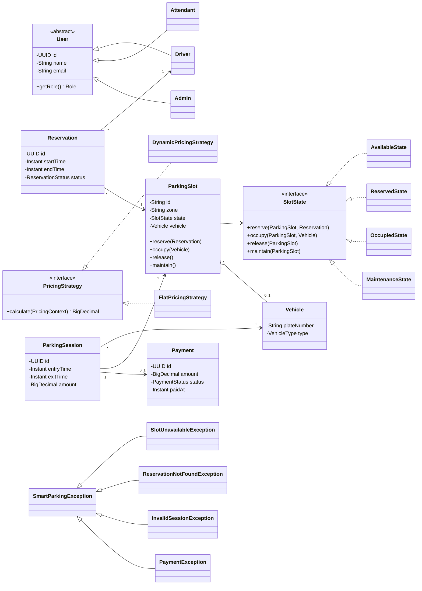
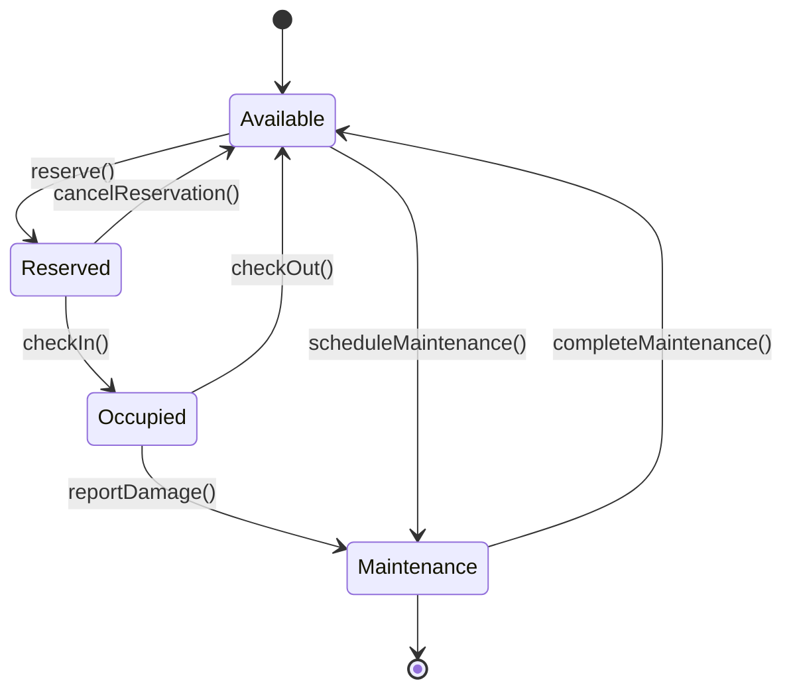
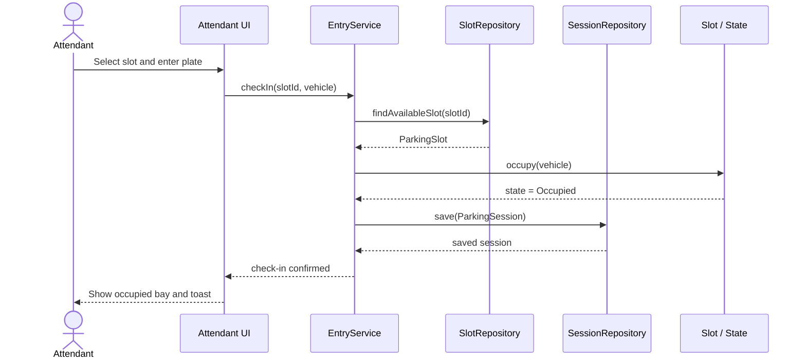
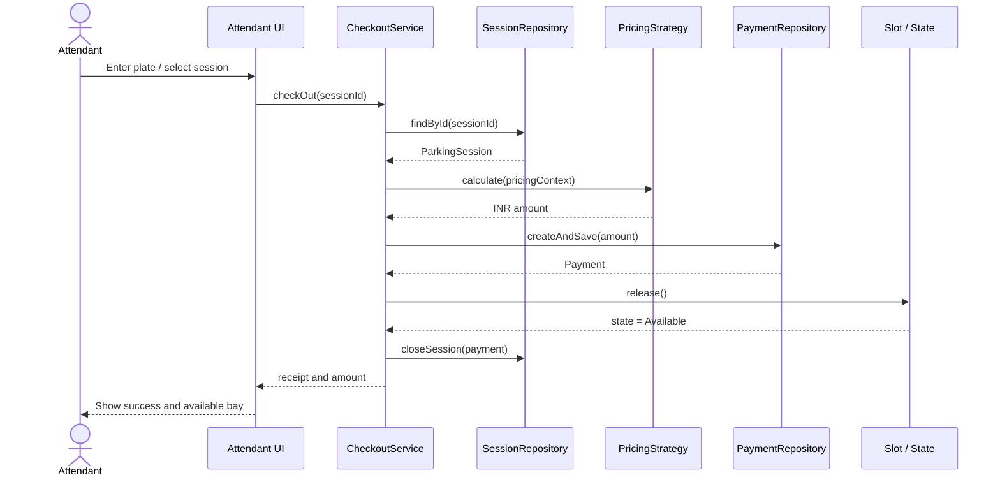
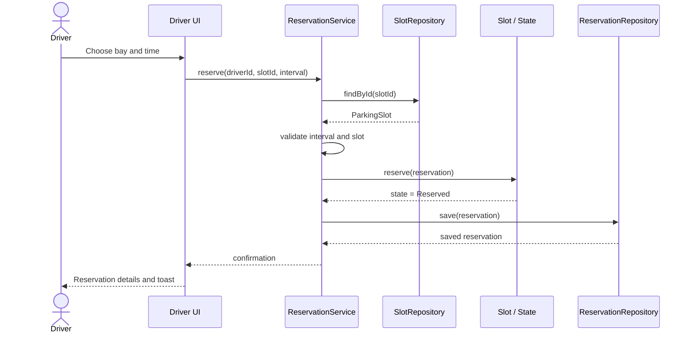
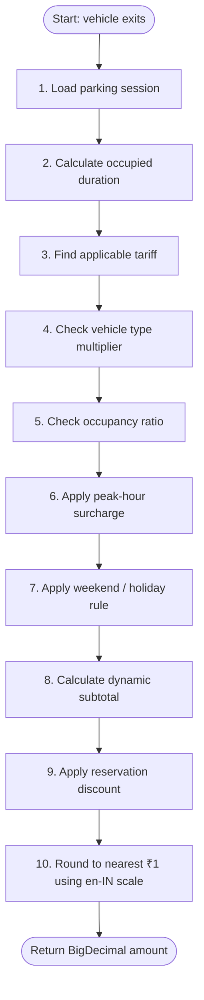

# SmartParking V2

**SmartParking V2** is a modern Java 17 and JavaFX 21 parking management system built with Maven. It uses a strict Domain → Service → Repository → UI architecture, INR (`₹`) pricing with an `en-IN` locale, Jackson JSON persistence, and JUnit 5 testing.

## Planned Architecture

```text
com.smartparking
├── domain       # Entities, state patterns, pricing strategies, and exceptions
├── repository   # Interfaces and JSON-backed implementations
├── service      # Reservation, check-in, check-out, and pricing workflows
└── ui           # JavaFX views, role navigation, CSS, charts, and transitions
```

The UI never implements parking business rules. Controllers call services, and services coordinate repositories and domain patterns.

## Roles

| Role | Scope |
|---|---|
| Driver | Reserve a bay, enter/exit details, view reservations and payments |
| Attendant | Check vehicles in and out, inspect bays, and record maintenance |
| Admin | Manage users, slots, tariffs, reports, and system-wide pricing |

## Use Case Diagram

```mermaid
usecaseDiagram
actor Driver
actor Attendant
actor Admin

rectangle "SmartParking V2" {
  usecase "Register / Login" as Auth
  usecase "View Parking Slots" as ViewSlots
  usecase "Make Reservation" as Reserve
  usecase "Cancel Reservation" as Cancel
  usecase "View Reservation" as MyReserve
  usecase "Make Payment" as Pay

  usecase "Vehicle Check-In" as CheckIn
  usecase "Vehicle Check-Out" as CheckOut
  usecase "View Slot Details" as SlotDetails
  usecase "Mark Maintenance" as Maintenance

  usecase "Manage Users" as Users
  usecase "Manage Parking Slots" as Slots
  usecase "Configure Pricing" as Pricing
  usecase "View Reports" as Reports
}

Driver --> Auth
Driver --> ViewSlots
Driver --> Reserve
Driver --> Cancel
Driver --> MyReserve
Driver --> Pay

Attendant --> Auth
Attendant --> CheckIn
Attendant --> CheckOut
Attendant --> SlotDetails
Attendant --> Maintenance

Admin --> Auth
Admin --> Users
Admin --> Slots
Admin --> Pricing
Admin --> Reports
```

## Class Diagram



## Parking Slot State Diagram



## Vehicle Entry / Check-In Sequence



## Check-Out and Payment Sequence



## Reservation Sequence



## Dynamic Pricing Calculation Flow



## Build & Run

```bash
mvn clean test
mvn javafx:run
```

Maven initially uses Java 17 and JavaFX 21 dependencies; the application shell will be added in later implementation steps.
